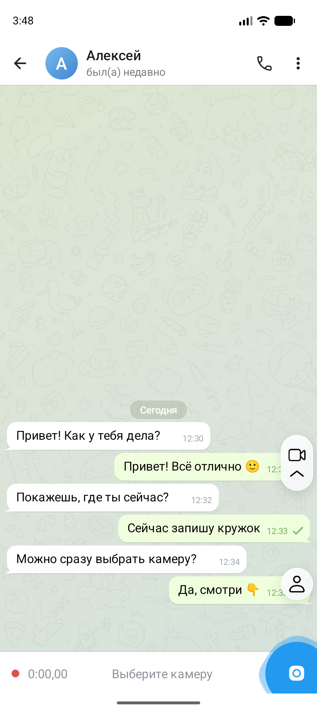
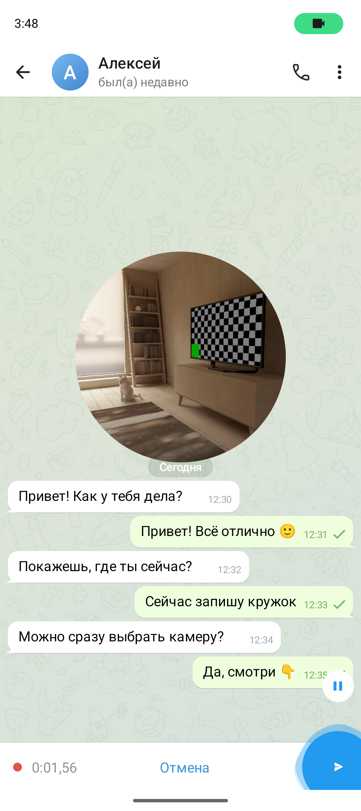

# Camera Select: выбор камеры перед записью кружка

Изменение Telegram Android: выбрать фронтальную или основную камеру одним свайпом до начала записи.

## Управление

1. Переключиться на кнопку видеосообщения и потянуть её вверх.
2. Короткий свайп и отпускание — фронтальная камера; длинный — основная.
3. Пока палец на экране, выбор можно менять слайдом в обе стороны. Удержание само по себе запись не запускает.
4. После отпускания начинается штатная закреплённая запись кружка. Бар записи, таймер, пауза, отмена и отправка остаются оригинальными.

Возврат к кнопке до отпускания отменяет выбор. Сдвиг влево отменяет жест. Короткое нажатие без свайпа сохраняет переключение между голосовыми и видеосообщениями.

## Внешний вид

[Исходный макет Figma](https://www.figma.com/design/VXU4prxOmPjdPvxV4PSaf4/telegram-camera-select-message?node-id=5-448).

- Сохранены две отдельные формы концепта: верхняя капсула с камерой и шевроном, нижний круг с человеком. Контуры значков взяты из Figma.
- Фон использует штатный движок стекла Telegram, цвета, тонировку, тени и режим энергосбережения клиента. Подкрашенные растровые имитации стекла не используются.
- Появление и смена выбранной камеры выполняются переиспользуемыми `SpringAnimation`. Таймеров удержания и постоянного опроса жеста нет.
- Нижняя граница круга располагается на **80 физических пикселей** выше верхней границы контейнера поля ввода. Это не 80 dp.
- Позиция корректируется после размещения родителем: учитывается дополнительное смещение шапки чата и системных отступов. Граница длинного свайпа соответствует фактическому положению элементов.

### Ранний прототип

Эти скриншоты показывают ранний автономный прототип, **не итоговый APK v6**. Нижняя панель макета служит ориентиром; отдельный бар записи поверх оригинального не добавляется.

<p>



</p>

## Применение патча

`changes.patch` содержит итоговую реализацию v6 относительно официального [Telegram Android на коммите `7be672ead283d022812d75c729d3a04dd4c2a2c6`](https://github.com/DrKLO/Telegram/tree/7be672ead283d022812d75c729d3a04dd4c2a2c6), версия **13.2.1 (7291)**. Патч нужно применять к чистой копии этого коммита, а не поверх старой версии `changes.patch`.

Из папки с исходниками Telegram:

```sh
git apply --check /path/to/telegram-camera-select-message/changes.patch
git apply /path/to/telegram-camera-select-message/changes.patch
```

Новые классы находятся в `TMessagesProj/src/main/java/org/telegram/ui/Components/cameraselect/`. Патч включает общий контракт выбора камеры и поддержку обоих рекордеров: `InstantCameraView` и `InstantCameraView2`. Направление камеры передаётся до открытия записи.

## API и сборка

Для входа нужны собственные `api_id` и `api_hash` из [my.telegram.org/apps](https://my.telegram.org/apps). Демонстрационные параметры исходного Telegram ограничены сервером и могут возвращать `API_ID_PUBLISHED_FLOOD`; см. [требования Telegram к API ID](https://core.telegram.org/api/obtaining_api_id).

Для входа в обычный аккаунт оставьте «Тестовый сервер» выключенным: это отдельная среда с отдельными аккаунтами и чатами.

Скопируйте `api.properties.example` в файл `api.properties` **рядом с папкой исходников Telegram** и заполните его локально:

```text
TelegramBuild/
  api.properties           # приватный файл с api_id и api_hash
  Telegram/                # исходники Telegram с применённым патчем
```

Gradle читает этот файл и формирует `BuildConfig.CLIENT_API_ID` / `CLIENT_API_HASH`. При отсутствии или неверном формате параметров сборка останавливается. Личные значения API не входят в этот репозиторий.

Остальная настройка SDK, NDK, подписи и локальных файлов выполняется по README исходного Telegram. Проверенная конфигурация: JDK 17, Gradle 8.13, Android SDK / Build Tools 36, NDK 27.2.12479018 и CMake 3.22.1. На Windows используйте путь к сборке без кириллицы: CMake/Ninja могут не обработать её корректно.

Основная задача сборки:

```sh
./gradlew :TMessagesProj_App:assembleAfatDebug
```

Если в исходниках нет `gradlew.bat`, на Windows можно запустить wrapper из PowerShell, находясь в папке Telegram:

```powershell
& "$env:JAVA_HOME/bin/java.exe" -classpath gradle/wrapper/gradle-wrapper.jar org.gradle.wrapper.GradleWrapperMain :TMessagesProj_App:assembleAfatDebug
```

Результат: `TMessagesProj_App/build/outputs/apk/afat/debug/app.apk`, пакет `org.telegram.messenger.beta`. Он устанавливается отдельно от обычного Telegram. В сборку входят ARM 32/64 и x86 32/64. Внутренние `DEBUG_VERSION` и `DEBUG_PRIVATE_VERSION` отключены, чтобы не запускать тяжёлые отладочные проверки при использовании.

### Необязательное ускорение через готовые нативные библиотеки

Java-код и ресурсы концепта можно пересобрать без повторной компиляции C++. Для этого нужны библиотеки из APK **той же версии 13.2.1 (7291)**. Использованный при проверке APK имел действительную подпись Telegram.

Поместите `lib/<abi>/libtmessages.49.so` из такого APK в соседнюю с исходниками папку `prebuilt-native/<abi>/libtmessages.49.so` для всех четырёх архитектур:

```text
TelegramBuild/
  api.properties
  prebuilt-native/
    arm64-v8a/libtmessages.49.so
    armeabi-v7a/libtmessages.49.so
    x86/libtmessages.49.so
    x86_64/libtmessages.49.so
  Telegram/
```

Затем добавьте `-PusePrebuiltNative=true` к задаче Gradle. Без этого параметра выполняется обычная сборка C++ из исходников. Нативные библиотеки, APK и личные параметры API в репозиторий не включены.

## Проверки

```sh
python tools/test_gesture.py
```

Нужны Python 3 и JDK с `java` / `javac` в `PATH` либо настроенным `JAVA_HOME`. Скрипт извлекает настоящие классы из патча и запускает проверки без клонирования Telegram:

- 19 проверок жеста: быстрые свайпы, смена камеры до отпускания, отмена и отсутствие самопроизвольной записи;
- 384 проверки отступа и выбора на восьми плотностях и шести положениях бара, включая смещение родителем на высоту шапки;
- проверка повторяемости состояния на миллионе последовательностей жеста; это не замер FPS приложения.

APK v6 собран, проверены его подпись, выравнивание, наличие четырёх архитектур и итогового кода. Пользователь подтвердил, что отступ исправлен и функция работает нормально. Штатные методы отрисовки бара и перехода в закреплённую запись сверены с исходным Telegram. Автоматических проверок камеры на устройстве и замеров плавности на S21 не проводилось.

Патч рассчитан на закреплённый коммит; другим версиям может понадобиться адаптация. Установленный официальный APK нельзя изменить одним применением патча — нужен собранный клиент.

Код распространяется по GNU GPL v2 или более поздней версии, как [исходный Telegram Android](https://github.com/DrKLO/Telegram/blob/7be672ead283d022812d75c729d3a04dd4c2a2c6/LICENSE).
