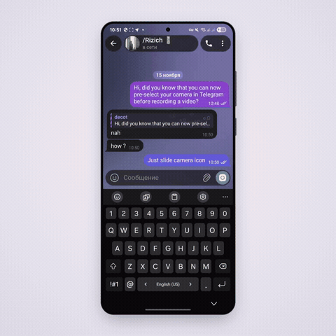
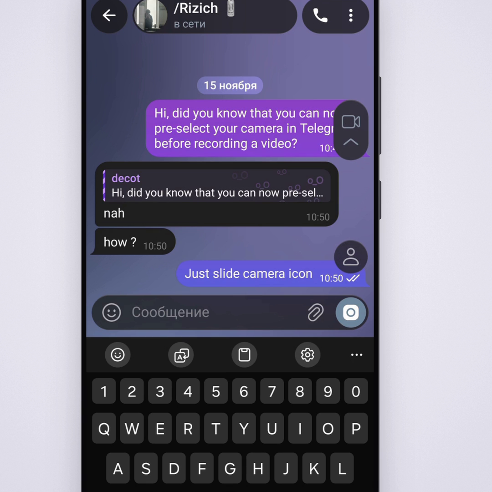
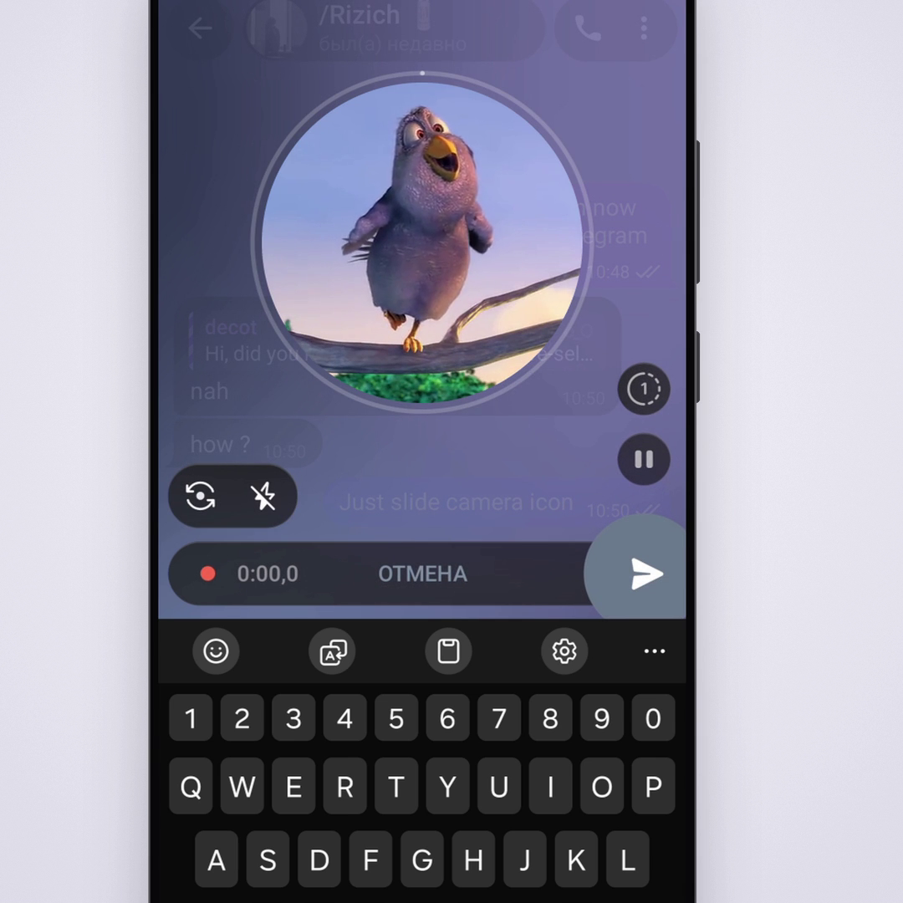
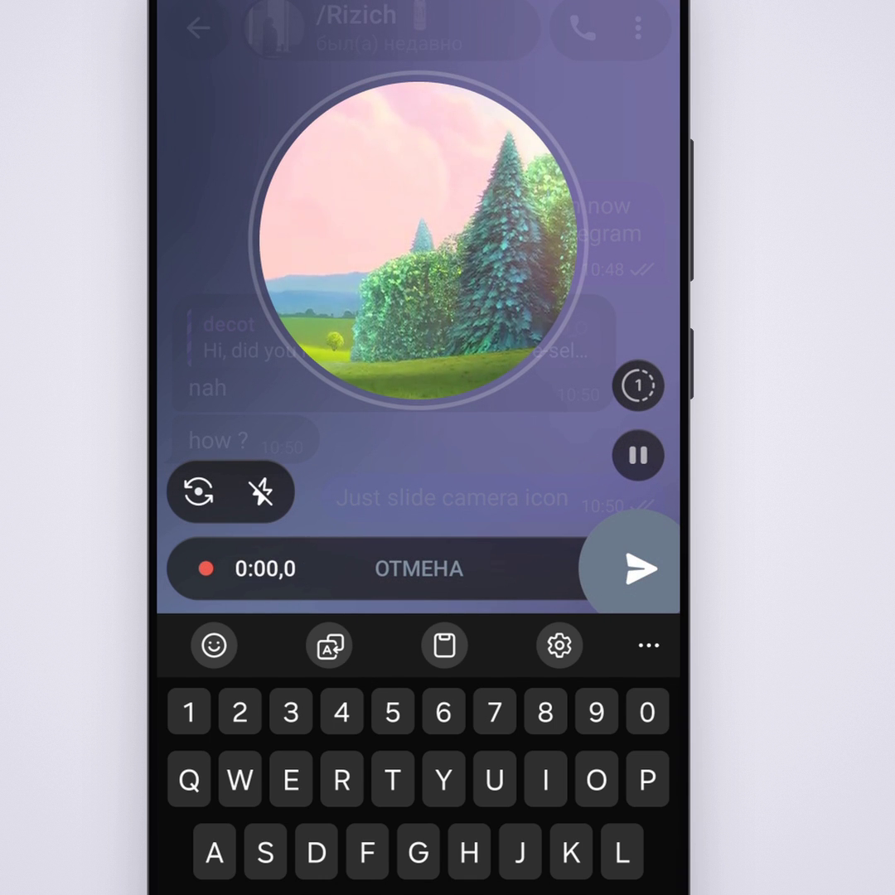

# Camera Select: choose your camera before recording a video note

Your face or the world around you? Choose before the video starts.

A gesture for **Telegram Android** that lets you select the front or rear camera before recording a round video message. Pull up from the video message button, choose a camera, and let go to start recording.

## Demo

<p align="center">
  <a href="https://github.com/decot01/telegram-camera-select-message/raw/refs/heads/main/media/demo.mp4">
    
  </a>
</p>

<p align="center">
  <a href="https://github.com/decot01/telegram-camera-select-message/raw/refs/heads/main/media/demo.mp4">Watch or download the full demo</a> · MP4 · 1080 × 1080 · 60 fps
</p>

The demo was captured from the Android build. The scenes inside the video notes were replaced for privacy. Demo footage: *Big Buck Bunny*, © 2008 Blender Foundation / [bigbuckbunny.org](https://www.bigbuckbunny.org/), [CC BY 3.0](https://creativecommons.org/licenses/by/3.0/); cropped, retimed and used without audio.

## Why

Sometimes you want to record yourself. Sometimes you want to show what is in front of you. Picking the camera first means the video starts with the view you intended, without switching cameras during the recording or starting over.

## What it does

### 1. Pull up to choose

Start with the video message button, then slide upward:

- **Short slide + release:** record with the front camera.
- **Longer slide + release:** record with the rear camera.

The two choices appear above the input bar, within reach of the same finger.

### 2. Change your mind before letting go

Keep your finger on the screen and slide between the choices. Holding does not start a recording: the camera is confirmed only when you release.

Slide back to the button to dismiss the selection, or move left to cancel the gesture. A quick tap still switches between voice and video messages.

### 3. Continue with Telegram's recording controls

Releasing starts the normal locked video-note recording with the selected camera. The recording bar, timer, pause, cancel and send controls use Telegram's existing behaviour.

<p align="center">
  
  
  
</p>

<p align="center"><em>Choose a camera → release to record. Different demo scenes distinguish the two cameras.</em></p>

## How it fits into Telegram

The selector uses Telegram's native glass background, theme colours, tinting and shadows. Its two shapes follow the [original Figma concept](https://www.figma.com/design/VXU4prxOmPjdPvxV4PSaf4/telegram-camera-select-message?node-id=5-448): a camera capsule above and a front-camera circle below. Reusable spring animations handle appearance and selection changes.

The camera direction is passed to the recorder before the camera session opens. Both `InstantCameraView` and `InstantCameraView2` are supported. This is a client-side change; it does not require a new server feature or a modified client on the receiving side.

## Applying the change

[`changes.patch`](changes.patch) contains the implementation against official **Telegram Android 13.2.1 (7291)** at commit [`7be672ead283d022812d75c729d3a04dd4c2a2c6`](https://github.com/DrKLO/Telegram/tree/7be672ead283d022812d75c729d3a04dd4c2a2c6).

From a clean checkout of that commit:

```sh
git apply --check /path/to/telegram-camera-select-message/changes.patch
git apply /path/to/telegram-camera-select-message/changes.patch
```

Then follow the [build and API setup](docs/BUILD.md). This repository contains a patch, rather than a full copy of Telegram. Apply it to the pinned base, not on top of an earlier version of the patch.

The new gesture, placement and selector code lives in `TMessagesProj/src/main/java/org/telegram/ui/Components/cameraselect/`. The patch also includes the chat integration, recorder hooks and local API configuration.

## Checks and limitations

```sh
python tools/test_gesture.py
```

The script extracts the actual classes from the patch and runs 19 gesture checks, 384 placement checks, and a repeatability check over one million gesture sequences. It requires Python 3 and a JDK. These are state and geometry checks, not an FPS benchmark.

- The implementation was built and manually tried on Android. Camera behaviour and animation smoothness do not have automated device tests.
- The patch targets the pinned Telegram version. Newer versions may need adaptation.
- Building requires your own Telegram API credentials. APKs, signing keys and private API settings are not included in this repository.

## Design and source

Concept and Android implementation by [@decot01](https://github.com/decot01). [Figma](https://www.figma.com/design/VXU4prxOmPjdPvxV4PSaf4/telegram-camera-select-message?node-id=5-448) · [Patch](changes.patch) · [Build instructions](docs/BUILD.md)

Code follows Telegram Android's [GNU GPL v2 or later license](https://github.com/DrKLO/Telegram/blob/7be672ead283d022812d75c729d3a04dd4c2a2c6/LICENSE).
